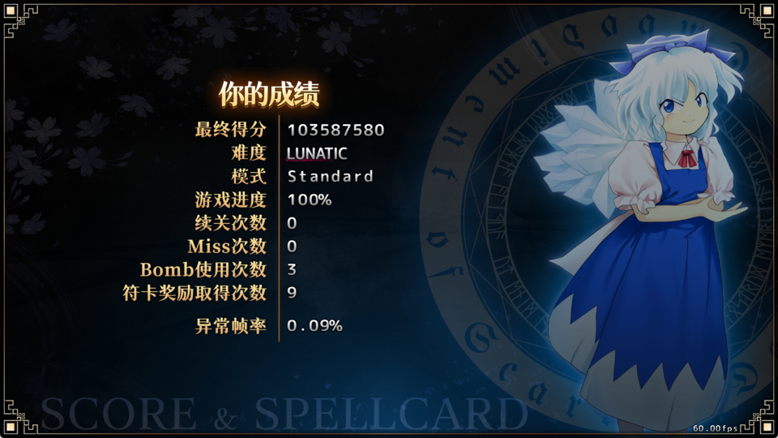
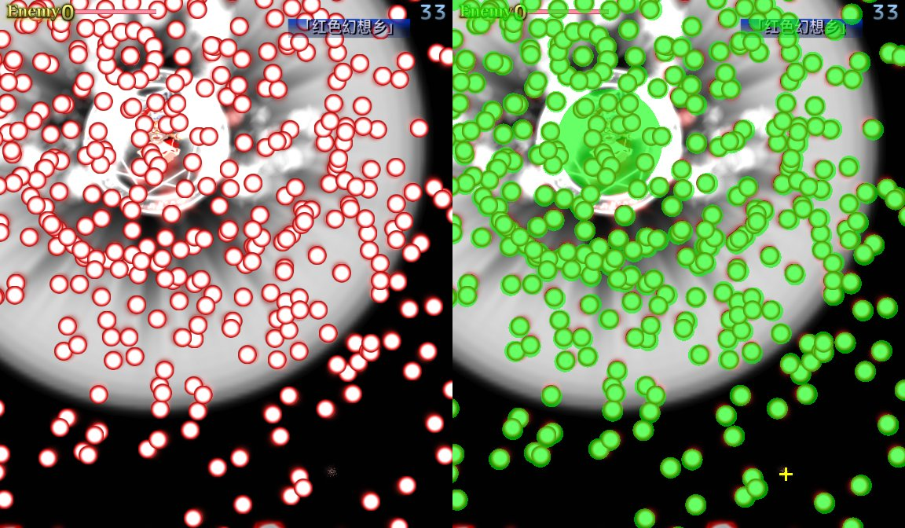

# Touhou EoSD New Classic bot: LUNATIC cleared with no continues

An AI that plays *Touhou Koumakyou ~ the Embodiment of Scarlet Devil, New Classic* (Steam, `th06nc.exe`) by itself, with
nobody at the keyboard. A convolutional policy trained with PPO in a GPU bullet-hell simulator does the dodging in the real game.
A short-range "reflex" layer checks every move against the bullets read (read-only) from the game's memory with their true
hitboxes, and decides when to bomb.

It has **cleared LUNATIC, Standard mode, without continuing, 11 times**, once from a fresh clone of this repository with
`run.ps1` and its defaults. **Best run: no miss at all** (103,587,580 points, 0 misses, 3 bombs). Highest score: 103,973,760
(1 miss, 6 bombs). The replays are in `media/`.

> **Does it memorise the stages? No.** Nothing in it stores a route, a timing or a pattern script.
>
> - The dodging policy (v11a), which picks every move, has **never seen the real game**. It learned only in a simulator, on
>   procedurally generated bullet patterns.
> - The only part that saw real-game data is the bullet-prediction network (rnn0). Half of its training data are danger masks that
>   the bot recorded while it played LUNATIC **Spell Practice**, from **7 spell cards** (3 more were recorded and held out). It
>   predicts the next second from the bullets already on screen, with no time, stage, script or random-number input. So it may know
>   those 7 cards a little better than the rest of the game.
> - The reflex layer and the bomb rule learn nothing. Game memory is read (never written) only for what is on screen right now:
>   positions, velocities and types of bullets, lasers and enemies, never the scripts or the RNG.
>
> Details: [What was trained on what](#training).



## Results (real game, no human input)

| Setup | Result |
|---|---|
| LUNATIC Standard mode, no continues (memory perception + reflex layer) | **Cleared 11 times** in the 13 games played at full decision rate; **7 of 7** since the reflex layer also moves enemies (2026-11-09) |
| **No-miss run (2026-11-09)** | Final score **103,587,580**, **0 misses**, 3 bombs, 9 spell card bonuses, 0 continues (replay: `media/th6_lunatic_clear_miss0.rpy`) |
| Highest score (2026-11-06) | **103,973,760**, 1 miss, 6 bombs, 13 spell card bonuses, 0 continues (replay: `media/th6_lunatic_clear_miss1.rpy`, result screen: `media/clear_result_lunatic_miss1.png`) |
| From a fresh `git clone` of this repo, `run.ps1` defaults (2026-11-08) | **Cleared**: 80,022,360, 2 misses, 10 bombs, 11 spell card bonuses, 0 continues (replay: `media/th6_lunatic_clear_from_clone_miss2.rpy`, result screen: `media/clear_result_from_clone_miss2.png`) |
| The other clears | 97.2M (1 miss); 94.9M, 89.1M, 87.2M, 85.4M (2 misses each); 73.9M, 64.6M (3 misses each); one more whose final score was not recorded |
| Pure-vision variant (bullets from the picture only) | 0 clears in 8 games; reaches stage 3-4 |

About **29.7 decisions per second** (the game runs at 60 fps: one decision every 2 frames).



## Quick start

**You need**

- Windows 10/11 and an NVIDIA GPU (developed on an RTX 5070 Ti)
- *Touhou Koumakyou New Classic* on Steam (`th06nc.exe` v1.03: the memory addresses are for this version). Set the game's
  **language to Simplified Chinese** (the bot finds the window by its Chinese title and reads the Chinese continue prompt) and keep
  the default windowed size (1280x720).
- Python 3.12 with PyTorch (CUDA build)

**1. Install** (once)

```powershell
git clone https://github.com/Ling777KK/THBot-T800.git
cd THBot-T800
pip install torch --index-url https://download.pytorch.org/whl/cu128
pip install -r requirements.txt
```

(Pick the PyTorch command for your CUDA version on [pytorch.org](https://pytorch.org); `cu128` works for RTX 50-series cards.)

**2. Check** (does not start the game)

```powershell
powershell -ExecutionPolicy Bypass -File .\run.ps1 -Check
```

It finds a Python that has PyTorch with CUDA and finds the game folder in your Steam libraries. If it cannot, pass them:
`-Python C:\path\to\python.exe`, `-GameDir "D:\SteamLibrary\steamapps\common\th06nc"`.

**3. Play**

```powershell
powershell -ExecutionPolicy Bypass -File .\run.ps1
```

Keep Steam running, then take your hands off the keyboard and mouse. The game starts after 20 s without input. The script:

1. the first time only: copies the game's original `th06CM.dat`, `th06ST.dat`, `th06IN.dat` to `C:\touhou-runs\game_backup\`;
2. switches the game to "AI mode" textures (see below);
3. starts the game through Steam and a new LUNATIC Standard game, and plays it with no continues;
4. at a game over: closes the game and switches the textures back.

| Option | Effect |
|---|---|
| `-Games 5` | play up to 5 games; stops at the first clear |
| `-Difficulty NORMAL` | `EASY`, `NORMAL`, `HARD` or `LUNATIC` (default) |
| `-NoBomb` | never press X |
| `-Vision` | the pure-vision variant: bullets from the picture only, memory only for the player's position |
| `-Out D:\touhou-out` | where results go (default `C:\touhou-runs`) |
| `-Restore` | close the game and switch the textures back (after Ctrl+C, or after saving a replay) |

**Results**: every game gets a folder `C:\touhou-runs\run_<date>_<time>_<n>\` with `summary.txt` (bombs, deaths, game over time,
decisions per second), `end_screen.png` and, in `run\`, a snapshot every 30 s and pictures of the last seconds before each miss.

**After a clear** the game is left open: press Z through the ending and the staff roll, enter a name, and save the replay into an
**empty** slot. Then run `run.ps1 -Restore`.

To stop early, press Ctrl+C in the PowerShell window, then run `run.ps1 -Restore`.

## How it works

```
game picture / game memory (read-only)
   |
   +- perception: bullets, lasers, enemies -> the same "danger mask" the simulator produces
   |  (realgame/perception.py, memperception.py)
   |
   +- dodging policy v11a: a CNN whose input is the masks of the last frames (30/16/8/4/2/1/0 frames back) plus
   |  player info; 18 actions (9 moves including "stay" x fast / focused). Trained only in the simulator with PPO
   |  (danmaku_env.py, ppo_train.py)
   |
   +- prediction network rnn0: predicts the bullets up to 1 s ahead from past masks; in play, a search over its first
   |  0.5 s vetoes actions that are clearly more dangerous than the best one
   |  (traj_net.py; trained on simulator data plus real-game recordings of 7 spell cards, see Training)
   |
   +- reflex layer: with each bullet's true hitbox, searches the next 10 frames for an escape route after each action.
   |  Bullets and enemies move on at their velocity (enemies: measured per slot between two reads).
   |  The key press takes effect 0-2 frames after the read, and every one of those timings must survive.
   |  An unsafe action is replaced (realgame/reflex.py)
   |
   +- bomb: X when even the best action survives at most one of the key timings
```

- **Simulator** (`danmaku_env.py`): PyTorch runs 512 bullet-hell environments at once on the GPU. There are 35 pattern families
  (aimed fans, rings, spirals, rain, accelerating aimed shots, knives that stop and then dash at the player, walls with gaps,
  laser-like sweeps, big orbs, ...). v11a trains on 26 of them; the rest are held out as unseen tests. A difficulty curriculum
  ramps up during training.
- **Policy**: `policy.py` (actor-critic CNN, about 3.79M parameters). v11a was trained for 40M steps, warm-started from v9a.
- **Game memory is read-only** (`realgame/gamemem.py`, ReadProcessMemory). It reads the player position, the bullets (position,
  velocity, type -> hitbox), lasers and enemies. It **never writes memory**, and it does not read pattern scripts, the RNG or anything
  else that tells the future (no memorising the stages).
- **"AI mode" textures** (`modding/gamemode.py ai | display | status`): backgrounds, spell-card backgrounds, the player sprite, her
  shots and some effects become transparent or solid black, so the picture is cleaner to read. This edits your local game archives:
  the AI versions are appended to the archives and switching only rewrites their table of contents, so `display` restores the
  original look. The originals are also kept in `C:\touhou-runs\game_backup\` (if anything goes wrong: Steam > the game's
  Properties > Installed Files > Verify integrity). All the clears were played in AI mode.
- Soft preferences, added to the policy's output only (they never restrict where the player can go): move under the boss when
  one is on screen (`--align`), under an enemy during the stage sections (`--enemy_align`), and under a falling bomb or 1UP item
  when no bullet is within 30 px (`--seek_bombs`; items are read from memory, read-only). The prediction veto and the reflex layer
  still check every move.

## Models (`models/`)

| File | Content |
|---|---|
| `v11a_policy.pt` | dodging policy (optimizer state removed, 15 MB) |
| `rnn0_traj.pt` | prediction network (2.4 MB) |
| `memperc_fit_types2.json` | size table used to draw the bullets read from memory into the mask |

## Running `play.py` by hand

`run.ps1` calls `realgame/full_std.ps1`, which runs `play.py` with these options (the setup of the clears):

```powershell
cd realgame
python ..\modding\gamemode.py ai
python play.py ..\models\v11a_policy.pt --newgame "3 standard C:\touhou-runs\myrun" --out C:\touhou-runs\myrun\run `
  --seconds 3600 --shoot --percep 5 --standard --continues 0 --end_after_no_field 40 `
  --align --enemy_align --traj ..\models\rnn0_traj.pt --traj_margin 0.2 --tint_q 0.1 `
  --memperc ..\models\memperc_fit_types2.json --reflex 10 --reflex_hold 4 --reflex_bomb --seek_bombs
python closegame.py; python ..\modding\gamemode.py display
```

`python play.py --help` lists every option. Environment variables: `TOUHOU_RUNS` (output folder), `TH06NC_DIR` (game folder),
`TOUHOU_PY` (Python used by the scripts).

## Training

```powershell
python ppo_train.py --name v11a --train_set v11 --lags 30,16,8,4,2,1,0 --blind 5.3,5.3,5.3 --big_draw 48,160 `
  --init_from C:\touhou-runs\v9a\ckpt.pt --total 40e6 --lr 1.5e-4 --gamma 0.995 --d_lo 0.4 --d_start 1.2 --d_max 1.4 --curriculum 0.05
python eval_policy.py C:\touhou-runs\v11a\ckpt.pt --argmax --suite v11 --diffs 0.9,1.2,1.4 --per_cond 32 --blind 5.3,5.3,5.3 --big_draw 48,160
```

v11a is the end of a chain of warm starts (v1 to v11); only the last step is shown.

**What was trained on what**

- The dodging policy (v11a) was trained **only in the simulator**: procedurally generated patterns, never footage of the real game.
- The prediction network (rnn0, `traj_train.py`) was trained half on simulator recordings (`traj_sim_record.py`, about 153k
  decisions) and half on danger masks recorded while the bot itself played LUNATIC **Spell Practice** in the real game
  (`play.py --dump_from 0 --dump_no_img`): 10 spell cards were recorded, 3 of them (s1c2, s5c1, s6c3) were held out and never trained
  on, so it learned from 7 cards (about 81k recorded decisions). It predicts the next second from the bullets already on screen; it gets no
  time, stage, script or random-number input. Still, it has seen those 7 cards, so it may know their patterns better than unseen ones
  (a later version trained on more cards was better only on the cards it had seen). A full game has many more spell cards and
  non-spell attacks than these 7.
- The reflex layer learns nothing: it moves the bullets and enemies read from memory in straight lines with their true hitboxes.
- `memperc_fit_types2.json` is a measurement of how big each bullet type is drawn on screen (for the memory masks).

## Layout

| File | What |
|---|---|
| `run.ps1` | one command to play (checks, backups, AI mode, games, restore) |
| `danmaku_env.py` | the GPU bullet-hell simulator (patterns, physics, observations, reward) |
| `policy.py`, `ppo_train.py`, `eval_policy.py` | the policy network, PPO training, evaluation in the simulator |
| `traj_net.py`, `traj_train.py`, `traj_sim.py`, `traj_sim_record.py` | the prediction network, its training and simulator recordings |
| `realgame/play.py` | the main loop in the real game: perception, policy, prediction veto, reflex, bombs, keys |
| `realgame/reflex.py` | the reflex layer |
| `realgame/perception.py`, `memperception.py`, `gamemem.py`, `tracker.py` | picture perception, memory perception (read-only), bullet tracking |
| `realgame/vision_proc.py`, `vision_table.py` | the pure-vision variant: per-frame capture process and bullet table from the picture |
| `realgame/newgame.py`, `closegame.py`, `ui.py`, `keys.py`, `winutil.py`, `setlang.py`, `difflabel.py`, `templates/` | starting / closing the game, keyboard, window, menus |
| `realgame/full_std.ps1` | one whole game (used by `run.ps1`) |
| `modding/gamemode.py`, `pkgl.py` | AI-mode texture switch (reads and writes the game's `.dat` archives) |
| `models/`, `media/` | trained models; result screens, AI-view picture, clear replays |

A few other modules (`foresight.py`, `future_env.py`, `memory_policy.py`, `memory_eval.py`, `validation_monitor.py`, `jitter_clock.py`,
`timing_profile.py`, `realgame/shield.py`) are optional features or experiments that the files above still import.

## Notes

- Enemies move too (fixed 2026-11-09). Remilia's bats in "Vampire Illusion" are enemies that fly at about 4.5 px per frame; the
  reflex layer used to treat enemies as standing still, and 3 of the highest-score run's 6 bombs went on that one spell card. Now each
  enemy's velocity is measured per slot between two memory reads, with the frames counted by that enemy's own timer (the bullet
  and enemy tables are read one after the other, and the game sometimes moves on a frame in between). Offline, actions wrongly judged
  safe near the bats dropped from 311-720 to 34-117 per game (7 games). The no-miss run was played with this.
- Unofficial fan project. Touhou Project is the property of Team Shanghai Alice. This repository contains no game data, only a
  few screenshots and the small UI templates used for recognition.
- For offline single-player use only. The replay was played by the AI; please do not submit it to leaderboards as a human score.
- The author directed this project; most of the code and experiments were done with an AI coding assistant (Claude Code).

## License

The code in this repository is MIT-licensed (see `LICENSE`). Touhou Project and *the Embodiment of Scarlet Devil* belong to
Team Shanghai Alice; this repository contains no game data. The screenshots and replays in `media/` show the game and are
included only to document the results.
